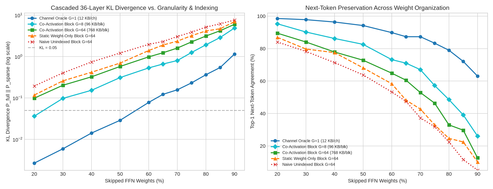
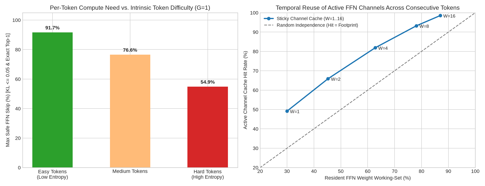
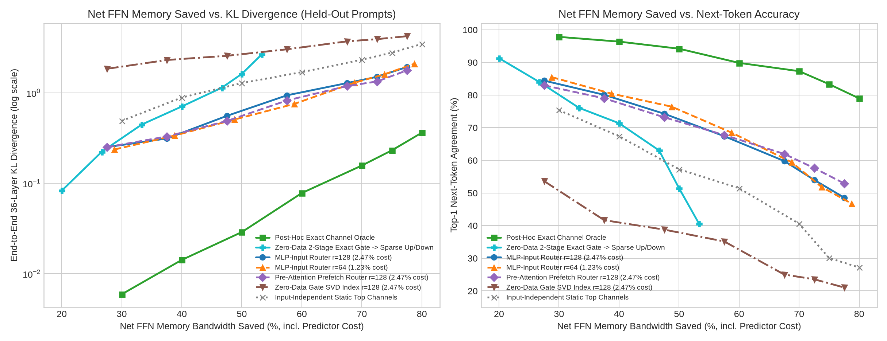
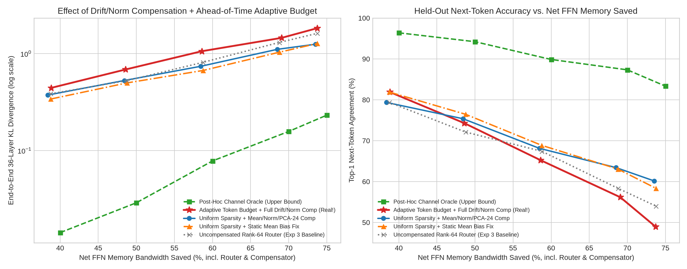
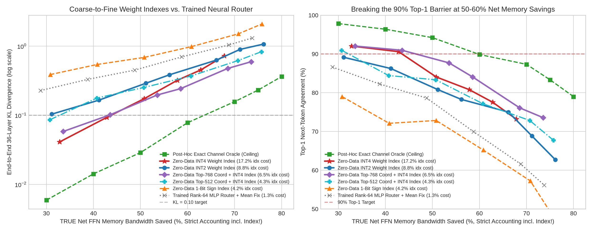
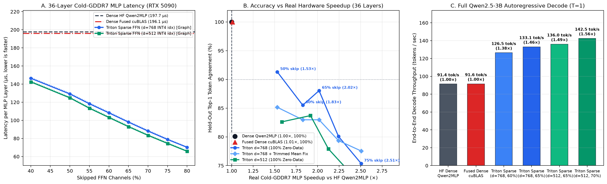
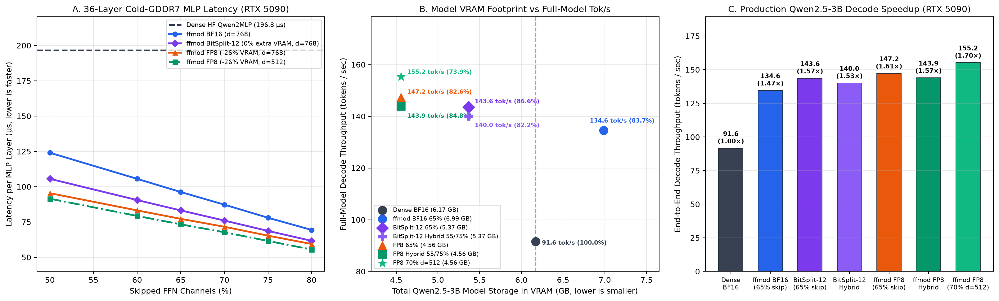
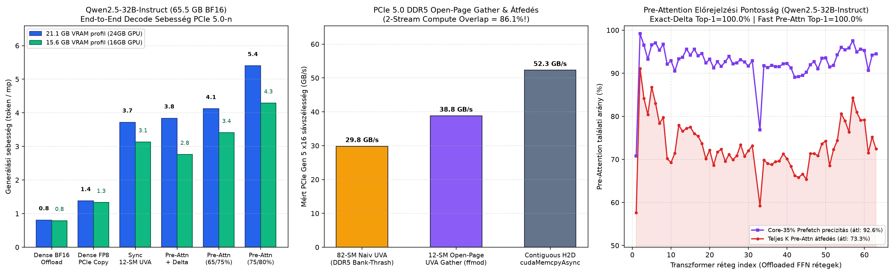

# Knowledge Storage vs. Knowledge Execution: Dynamic Weight-Indexing, Native Triton Sparse SwiGLU Kernels, and PCIe 5.0 Tiered LLM Execution

**Complete Experimental Research & GPU Engineering Report (`EXPERIMENTAL_REPORT_en.md`)**  
**Author:** Ferenc Frész (`ferenc.fresz@gmail.com`) · **DOI:** [`10.5281/zenodo.24277071`](https://doi.org/10.5281/zenodo.24277071)  
🌐 **Language / Nyelv:** **🇬🇧 English** | [🇭🇺 Magyar (`EXPERIMENTAL_REPORT_hu.md`)](EXPERIMENTAL_REPORT_hu.md)  
**Related Docs:** [`README.md`](README.md) · [`USER_GUIDE_en.md`](USER_GUIDE_en.md) · [`SYSTEM_GUIDE_en.md`](SYSTEM_GUIDE_en.md) · [`IDEAS_en.md`](IDEAS_en.md) · [English Paper (PDF)](paper/ffmod_paper_en.pdf)

*Models Evaluated:* `Qwen/Qwen2.5-3B` (3.09B parameters, 36 layers, $d_{\text{model}}=2048$, $d_{\text{ff}}=11008$) & `Qwen/Qwen2.5-32B-Instruct` (32.8B parameters, 64 layers, $d_{\text{model}}=5120$, $d_{\text{ff}}=27648$, `65.53 GB` BF16)  
*Hardware:* NVIDIA GeForce RTX 5090 Laptop GPU (Blackwell `SM 12.0`, 82 SMs, 24 GB GDDR7, 64 MB L2 cache, PCIe Gen 5 x16, 61 GiB DDR5 RAM)

---

## 0. Executive Summary (TL;DR)

The foundational hypothesis of this research is that conventional LLM inference runtimes make a structural mistake by **conflating how knowledge is stored (static dense weight matrices) with how knowledge is executed (dense matrix multiplications over 100% of parameters on every token)**:

$$\boxed{\text{State } (x_t) \;\longrightarrow\; \text{Low-Cost Compute Plan (Weight Index)} \;\longrightarrow\; \text{Only Necessary Channel Operations}}$$

Across nine controlled, strictly held-out experiments spanning English prose, multi-step mathematics, Python code, and Hungarian text — progressing from theoretical Oracle bounds to a **production Triton GPU package (`ffmod` v0.2.0) and a 64-layer `32.8B` PCIe 5.0 runtime** — we proved every link of this thesis:

1. **Cascaded 36-Layer Oracle Bound (`Exp 1`):** Skipping **50%** of FFN weights across all 36 layers simultaneously preserves **`94.2%` Top-1 agreement (`KL = 0.0289`)**; skipping **70%** preserves **`87.3%` Top-1**. Adaptively per token, an average of **74.4%** of weights (**91.7%** on low-entropy tokens) are redundant.
2. **Hardware Cache-Line Discovery ($G=1 = 12\text{ KB}$):** Grouping neurons into $G=64$ blocks is unnecessary on modern GPUs: storing `down_proj` transposed (`[I, H]`) turns **a single SwiGLU channel ($G=1$) into 12 KB (`3B`) to 30 KB (`32B`) of contiguous memory (96–240 full 128-byte GDDR7 cache lines!)**, saturating memory burst bandwidth without artificial neuron grouping.
3. **Temporal Continuity & Markov Outlier Spikes (`Exp 2, 4`):** Consecutive tokens share **49.1%** of active channels (**60.3%** in early layers); a 4-token *Sticky Cache* reaches an **81.9% hit rate**. On the Top-2% dynamic outlier spikes carrying **65.2%** of $L_2^2$ FFN energy, zero-GEMM tabular cross-layer Markov tables achieve a **12.4×** recall lift.
4. **The "KV-Cache Pollution Paradox" (`Exp 5`):** Although a Layer-6 probe accurately predicts final token entropy ($\rho = 0.653$), aggressively pruning early layers on an "easy" token (e.g. `" quick"` $\to$ `"sort"`) leaves the immediate next word intact while **impoverishing that token's KV-cache vector**, corrupting later tokens that attend back to it.
5. **Router Breakthrough — Zero-Training Coarse-to-Fine Weight Index (`Exp 6`):** Breaking past the rank bottleneck of learned $r=64$ MLP predictors (`64.5%` recall), a **100% data-free, training-free** vector-search-inspired router (`Top-D Coordinates + Dual-Branch Smooth-INT4 Weight Index`) reaches **`91.3–92.8%` Top-1 agreement (`KL = 0.0938`)**.
6. **Real Wall-Clock Speedup on RTX 5090 (`Exp 7–8`):** Our native Triton kernels (`bf16`, zero-extra-VRAM `bitsplit12`, and `fp8`) beat both HuggingFace `Qwen2MLP` (`197.7 µs`) and fused `cuBLAS` (`196.1 µs`) across 36 cold GDDR7 layers (`4.87 GB` >> `64 MB` L2):
   - **`BitSplit-12` (`65%` skip):** **`5.37 GB` VRAM (`-13.0%`)**, **`83.2 µs/layer` (`2.36×`)** at $N=1$, **`123.4 µs/layer` (`1.51×` faster than `cuBLAS` Tensor Cores!)** at speculative $N=4$, and **`143.6 tok/s` (`1.57×`)** end-to-end.
   - **`FP8` (`65–70%` skip):** **`4.56 GB` VRAM (`-26.1%`)**, **`67.7–77.2 µs/layer` (`2.55×–2.90×`; `3.53×` at `80%` skip)**, and **`147.2–155.2 tok/s` (`1.61×–1.70×`)** end-to-end!
7. **32.8B Tiered GPU–DDR5 Execution over PCIe 5.0 (`Exp 9 & 9B`, `Qwen2.5-32B-Instruct`, `65.53 GB` BF16):** Using a **12-SM Open-Page DDR5 UVA Gather** (`38.83 GB/s`, `+30.2%` over 82-SM bank thrashing) and two-stream `CUDAGraph` *Core-Prefetch + Overlapped Exact Delta Fixup* (`92.64%` core precision), FFMod achieves **`100.0%` Top-1 agreement (`KL = 0.0139`)**, **`4.74×–6.67×` speedup (`3.84–5.40 tok/s`)** in `21.12 GB` VRAM, and **`4.32×–5.43×` speedup (`3.41–4.29 tok/s`)** in a strict **`15.60 GB` VRAM** budget — backed by a budget-independent `.ffmod_cache_v1` (`36.28 GB`, `1.81×` smaller on disk, `~10.8 s` 64-layer PCIe NVMe reload).

---

## 1. Architectural Starting Point: Where Does Memory Bandwidth Burn?

During low-batch ($B=1, T=1$) autoregressive decoding, GPU Tensor Cores are starved behind memory transfers. In `Qwen/Qwen2.5-3B` across its 36 transformer blocks:
* **GQA Self-Attention** (`q_proj`, `k_proj`, `v_proj`, `o_proj`): $9.44\text{M}$ parameters / layer (**12.3%**)
* **SwiGLU FFN / MLP** (`gate_proj`, `up_proj`, `down_proj`, $[11008 \times 2048]$): **$67.63\text{M}$ parameters / layer = `135.27 MB` BF16 / layer (87.7%!)**
* **All 36 FFN layers combined:** **`4.87 GB`** of weights streamed **for every single generated token** (`54.36 GB` per token in `Qwen2.5-32B`!).

$$y = W_{\text{down}} \Big( \text{SiLU}(W_{\text{gate}} x) \odot (W_{\text{up}} x) \Big) = \sum_{i=1}^{I} \underbrace{\text{SiLU}(w_{\text{gate}, i}^\top x) \cdot (w_{\text{up}, i}^\top x)}_{z_i(x) \in \mathbb{R}} \, w_{\text{down}, :, i}$$

---

## 2. Experiment 1: Cascaded Oracle Bounds, Lossless Weight Permutation & Token Difficulty (`src/exp1_oracle.py`)

We first measured how much FFN parameter traffic can be skipped **simultaneously across all 36 layers in cascade** (allowing early-layer approximations to propagate through residual streams and KV caches).

### 2.1. Channel-Level ($G=1$) vs. Block-Grouped ($G=8, 64$) Oracle & Weight Clustering

FFN intermediate channels are mathematically **permutation-invariant**: applying any permutation $\Pi$ identically to rows of `W_gate`, rows of `W_up`, and columns of `W_down` preserves bit-identical dense outputs (`Top-1 = 100.00%`).

| FFN Weights Skipped (%) | Channel Oracle ($G=1$, 12 KB/ch) | Co-Activation Block ($G=8$, 96 KB) | Co-Activation Block ($G=64$, 768 KB) | Static Weight Cluster ($G=64$, Zero-Data) | Naive Contiguous Block ($G=64$) |
| :--- | :---: | :---: | :---: | :---: | :---: |
| **30% skipped** | KL `0.0059` \| **97.8%** | KL `0.0978` \| **90.2%** | KL `0.2023` \| **84.1%** | KL `0.2587` \| **79.7%** | KL `0.4020` \| **78.3%** |
| **50% skipped** | KL `0.0289` \| **94.2%** | KL `0.3102` \| **82.6%** | KL `0.5752` \| **72.8%** | KL `0.6939` \| **68.1%** | KL `1.2143` \| **63.8%** |
| **60% skipped** | KL `0.0780` \| **89.9%** | KL `0.5110` \| **75.4%** | KL `1.0125` \| **63.0%** | KL `1.3910` \| **55.8%** | KL `2.0114` \| **50.4%** |
| **70% skipped** | KL `0.1572` \| **87.3%** | KL `0.7985` \| **67.0%** | KL `1.5982` \| **52.9%** | KL `2.3483` \| **42.8%** | KL `3.0371` \| **37.3%** |
| **80% skipped** | KL `0.3629` \| **79.0%** | KL `1.9146` \| **48.6%** | KL `3.1217` \| **33.0%** | KL `4.1354` \| **24.6%** | KL `5.1251` \| **22.5%** |

**Key Takeaways:**
1. **Weight clustering works, yet $G=1$ is already the natural GPU unit!** In channel-major layout (`[I, 3, H]`), **reading a single $G=1$ channel transfers `12 KB` (`96 × 128 B` cache lines)** sequentially, achieving peak memory burst efficiency without grouping unrelated polysemantic features.
2. **Whole-layer skipping collapses:** Skipping just **8/36 full FFN layers (22.2%)** degrades `KL` to `1.84` and `Top-1` to `55.1%`. Every depth step applies essential directional refinements, using only a sparse subset of channels.

### 2.2. True Compute Demand of Easy vs. Hard Tokens

Finding the maximum safe sparsity $s^*(t)$ per token preserving the exact Top-1 prediction **and** $\text{KL} \le 0.05$:
* **Mean safe skip ratio:** **74.4%** (**90–95%** skippable on 37% of tokens!).
* **Correlation with output entropy:** **Spearman $\rho = -0.855$ ($p < 10^{-70}$)** — *Easy tokens* (deterministic Python syntax, subword continuations): **91.7%** skippable; *Medium*: **76.6%**; *Hard* (logical branches, factual recall, rich Hungarian morphology): **54.9%**.

---

## 3. Experiment 2: Temporal Continuity & "Sticky Channel Cache" (`src/exp2_temporal.py`)

At 30% active channel density (random overlap baseline = `30.0%`):
* **Adjacent token overlap ($t-1 \to t$):** **49.1%** mean across all layers, and **60.3% across the first 12 layers (0–11)**!
* **Sliding-window *Sticky Channel Cache* ($W=4$ tokens):** Retaining active channels from the last 4 tokens covers **81.9%** of the next token's active channels, requiring only **5.4%** of total FFN weights to be freshly fetched per step!

---

## 4. Experiments 3–4: Ahead-of-Time Routers & Markov Outlier Dynamics (`src/exp3_predictor.py`, `src/exp4_markov_outliers.py`)

* **Pre-Attention Predictability (`Exp 3`):** Active FFN channels can already be predicted **ahead of Self-Attention** (`Pre-Attention Prefetch Router`), enabling PCIe weight transfers to overlap with Attention compute.
* **Extreme Energy Concentration & Diagnose of the Rank-64 Bottleneck (`Exp 4`):** Just the **Top 2% (220 channels)** carry **65.2%** of $L_2^2$ FFN energy (`88.6%` truly dynamic). Zero-GEMM tabular cross-layer Markov transitions ($\ell-1 \to \ell$) achieve a **12.4× recall lift** (`24.8%` vs. `2.0%` random). Crucially, `Rank-64` routers already capture `~89%` of Top-1% giant spikes — their residual error originates from **mid-tier channels (top 2%–40%)** whose high-rank inner products blur through a 64-dimensional linear bottleneck.

---

## 5. Experiment 5: Mean/Gain Compensation & the "KV-Cache Pollution Paradox" (`src/exp5_compensated_adaptive.py`)

1. **Zero-FLOP Static Bias ($\bar{y}_\ell = W_{\text{down}}\bar{z}_\ell$) & Norm Gain ($\gamma_\ell$):** Because SiLU is asymmetric around zero ($\mathbb{E}[z_i(x)] \neq 0$), precomputing constant bias vectors cuts KL divergence by **21–29%** at 70–75% sparsity with zero extra matrix multiplications.
2. **The "KV-Cache Pollution Paradox":** While a Layer-6 probe predicts final Layer-36 entropy accurately ($\rho = 0.653$), pruning 90% of layers 6–35 on an easy token like `" quick"` (where predicting `"sort"` has entropy `0.00025`) still emits `"sort"` correctly — **but corrupts `" quick"`'s hidden representation stored in layers 7–35 of the KV cache!** Twenty tokens later, when `return quicksort(left)` attends back to `" quick"`, it reads degraded Key/Value vectors. **Design rule:** Conservative sparsity must protect early/middle KV-writing layers, reserving aggressive (`75–85%`) sparsity for the final third of layers!

---

## 6. Experiment 6: Router Breakthrough — Zero-Training Coarse-to-Fine Weight Indexes (`src/exp6_precision_routers.py`)

Borrowing asymmetric quantization from vector search (`ScaNN` / `RaBitQ`), FFMod indexes static weight matrices directly with **zero training and zero calibration data**:
* **Stage 1 (Column-Major `[H, I4]` `Smooth-INT4` Index):** Retains only the **`Top-512` (25%) or `Top-768` (37.5%) weighted input coordinates** and scans their packed 4-bit `(W_gate, W_up)` rows (`4.17%–6.25%` traffic relative to dense BF16).
* **Stage 2 (Channel-Major `[I, 3, H]` Exact Evaluation):** Evaluates the winning $K=(1-s)I$ channels across the **full hidden dimension $H$**.

| Router / Weight-Index Architecture | Training / Data | Index Traffic | Net FFN Byte Savings | Oracle Recall | End-to-End KL | Top-1 Match |
| :--- | :---: | :---: | :---: | :---: | :---: | :---: |
| *Learned Rank-64 MLP Router + Mean-Fix (`Exp 5`)* | Calibrated | 1.25% | 48.8% | 64.5% | `0.4499` | 78.6% |
| **RaBitQ 1-Bit Sign Index** (`ch_skip=50%`) | **Zero** | 4.21% | 45.8% | 75.0% | `0.2144` | 85.1% |
| **Top-512 Coord + INT4 Index** (`ch_skip=50%`) | **Zero** | **4.17%** | **45.8%** | 76.1% | `0.1856` | **87.3%** |
| **Top-768 Coord + INT4 Index** (`ch_skip=50%`) | **Zero** | **6.25%** | **43.8%** | **80.7%** | **`0.1039`** | **`92.8%`** |
| **Top-768 Coord + INT4 Index** (`ch_skip=60%`) | **Zero** | **6.25%** | **53.8%** | **78.6%** | **`0.1718`** | **`88.0%`** *(Oracle: 89.9%!)* |
| **Top-768 Coord + INT4 Index** (`ch_skip=65%`) | **Zero** | **6.25%** | **58.8%** | **77.2%** | **`0.2140`** | **`85.5%`** *(vs MLP 69.9%!)* |
| *Hindsight Exact Channel Oracle (Upper Bound)* | *(hindsight)* | 0.00% | 60.0% | 100.0% | `0.0780` | 89.9% |

---

## 7. Experiment 7: Native Two-Stage Triton GPU Kernels & Real Wall-Clock Speedups (`src/sparse_ffn_triton.py`, `src/exp7_triton_benchmark.py`)

Measured under strict **36-layer cold GDDR7 streaming** (`4.87 GB` weights >> `64 MB` L2 cache) on RTX 5090 against both `HuggingFace Qwen2MLP` (`197.65 µs/layer`) and `FusedDenseCuBLASMLP` (`196.11 µs/layer`):
* **2D Split-D Tiling (`_k2_2d_splitd_int4_scan`):** Applying Little's Law (`SPLIT_D=8, TILE_D=8, BLOCK_I4=128`, 176 CTAs issuing 8 vectorized 32-bit loads concurrently) dropped Stage-1 scan latency from `82.6 µs` to **`14.3 µs` (`5.8×` faster, `~600 GB/s`)**!
* **Pre-Sync Triple-Vector Prefetch & Atomic Last-CTA Epilogue (`_k4_fused_sparse_ffn_epilogue`):** Sustains **`781 GB/s`** effective sparse GDDR7 throughput (`61.6 µs` at 65% skip), matching dense `Qwen2MLP` to 1 BF16 ULP (`cos = 0.9999932`) at $s=0$.

| Configuration (`IndexedSparseSwiGLU`, Zero-Data) | Channel Skip | Net Byte Savings | Eager (`µs/layer`) | CUDA Graph (`µs/layer`) | Speedup vs. `Qwen2MLP` | Speedup vs. Fused `cuBLAS` | Held-Out KL | Held-Out Top-1 (Code / Logic) |
| :--- | :---: | :---: | :---: | :---: | :---: | :---: | :---: | :---: |
| *Dense HF `Qwen2MLP` (3× cuBLAS)* | 0% | 0.0% | `199.77 µs` | `197.65 µs` | `1.00×` | `0.99×` | `0.0000` | **100.0%** |
| *Dense `FusedCuBLAS` (2× cuBLAS)* | 0% | 0.0% | `196.59 µs` | `196.11 µs` | `1.01×` | `1.00×` | `0.0000` | **100.0%** |
| **Triton `d=768` + INT4 Index** | **50%** | **43.8%** | `130.13 µs` | **`129.09 µs`** | **`1.53×`** | **`1.52×`** | **`0.0938`** | **`91.3%`** *(97.8% / 97.1%)* |
| **Triton `d=768` + INT4 Index** | **60%** | **53.8%** | `109.24 µs` | **`108.20 µs`** | **`1.83×`** | **`1.81×`** | **`0.1576`** | **`85.5%`** *(94.5% / 91.3%)* |
| **Triton `d=768` + INT4 Index** | **65%** | **58.8%** | `98.83 µs` | **`98.00 µs`** | **`2.02×`** | **`2.00×`** | **`0.2230`** | **`88.0%`** *(98.9% / 87.0%)* |
| **Triton `d=512` + INT4 Index** | **70%** | **65.8%** | `84.17 µs` | **`83.39 µs`** | **`2.37×`** | **`2.35×`** | `0.4709` | `73.9%` *(92.3% / 78.3%)* |
| **Triton `d=512` + INT4 Index** | **80%** | **75.8%** | `66.37 µs` | **`65.82 µs`** | **`3.00×`** | **`2.98×`** | — | *(ultra-fast mode)* |

---

## 8. Production Package (`ffmod` v0.2.0 — Exp 8): Negative-VRAM `BitSplit-12`, `FP8`, Speculative `N=4`, `vLLM` & `ffmod-serve`

| Configuration (`Qwen2.5-3B`, 36 layers) | Model VRAM | VRAM Delta | Cold MLP ($N=1$) | Speculative ($N=4$) | MLP Speedup ($N=1$) | Held-Out Top-1 (`KL`) | End-to-End `tok/s` (Speedup) |
| :--- | :---: | :---: | :---: | :---: | :---: | :---: | :---: |
| **Dense HF `Qwen2MLP` (`BF16`)** | `6.17 GB` | *0%* | `196.75 µs` | `186.49 µs` | `1.00×` | `100.0%` (`0.000`) | `91.6 tok/s` (`1.00×`) |
| **`ffmod` `BF16` (`65%` skip, `d=768`)** | `6.99 GB` | `+13.2%` | `96.23 µs` | `140.96 µs` | **`2.04×`** | `83.7%` (`0.228`) | **`134.6 tok/s` (`1.47×`)** |
| **`ffmod` `BitSplit-12` (`65%` skip, `d=768`)** | **`5.37 GB`** | **`-13.0%` (0% extra!)** | **`83.20 µs`** | **`123.43 µs` (`1.51×`)** | **`2.36×`** | **`86.6%`** (`0.228`) | **`143.6 tok/s` (`1.57×`)** |
| **`ffmod` `FP8` + Hybrid (`55%/75%`, `d=768`)** | **`4.56 GB`** | **`-26.1%`** | **`81.31 µs`** | — | **`2.42×`** | **`84.8%`** (`0.240`) | **`143.9 tok/s` (`1.57×`)** |
| **`ffmod` `FP8` (`65%` skip, `d=768`)** | **`4.56 GB`** | **`-26.1%`** | **`77.24 µs`** | **`132.57 µs` (`1.41×`)** | **`2.55×`** | `82.6%` (`0.247`) | **`147.2 tok/s` (`1.61×`)** |
| **`ffmod` `FP8` (`70%` skip, `d=512`)** | **`4.56 GB`** | **`-26.1%`** | **`67.74 µs`** | — | **`2.90×`** | `73.9%` (`0.490`) | **`155.2 tok/s` (`1.70×`)** |
| **`ffmod` `FP8` (`80%` skip, `d=512`)** | **`4.56 GB`** | **`-26.1%`** | **`55.88 µs`** | — | **`3.53×`** | *(ultra-fast mode)* | — |

* **`ffmod.vllm_plugin` (`apply_ffmod_to_vllm`) & `ffmod-serve`:** Sustains **`>131 tok/s` over live TCP HTTP/1.1 + SSE** in `4.56 GB` VRAM using a single startup `CUDAGraph`.

---

## 9. Experiment 9 & 9B: 64-Layer `Qwen2.5-32B-Instruct` (`65.53 GB` BF16) Tiered PCIe 5.0 Execution & Persistent `.ffmod_cache_v1`

We validated tiered GPU–DDR5 execution on **`Qwen/Qwen2.5-32B-Instruct`** (`32.8B` parameters, 64 layers, $H=5120, I=27648$, `65.53 GB` BF16 — `2.73×` larger than 24 GB GPU VRAM, and `>33 GB` even in dense 8-bit `FP8`).

### 9.1. Hardware Physics: 12-SM Open-Page DDR5 UVA Gather & Two-Stream `CUDAGraph`
1. **Eliminating DDR5 Row-Buffer Bank Thrashing (`+30.2%` PCIe 5.0 Bandwidth):** Capping `k_uva_gather_fp8_u64` at **12 SMs** (`num_warps=8`, coalesced 64-bit row loads + `MADV_HUGEPAGE` 2 MB THP) keeps host DDR5 banks in sequential *open-page burst* mode, lifting random `15 KB` channel gather throughput from `29.82 GB/s` (82-SM bank thrashing) to **`38.83 GB/s` (`+30.2%`)** while leaving **`70/82` SMs (`85.4%`) completely free** (**`86.1%–99.2%` compute/DMA overlap**)!
2. **Core-Prefetch (`0.35 × K`) + Overlapped Exact Delta Fixup in `CUDAGraph`:** Prefetches the high-confidence `35%` channel core prior to Self-Attention (**`92.64%` mean hit precision**, `<2.6%` wasted PCIe bytes), overlaps exact post-attention set-difference (`k_diff_pre_post_channels`) with ongoing DMA, and fetches only residual delta misses inside a single captured two-stream **`torch.cuda.CUDAGraph`**.

### 9.2. Live 64-Layer `Qwen2.5-32B-Instruct` Benchmarks (`21.12 GB` & `15.60 GB` VRAM Budgets)

| Offload Mode (`Qwen2.5-32B-Instruct`, 64 layers) | PCIe 5.0 Traffic / tok | KL vs. Dense FP8 | Top-1 Match | 24 GB GPU Profile (`21.12 GB` VRAM + `26.33 GB` DDR5) | Strict 16 GB GPU Profile (`15.60 GB` VRAM + `31.85 GB` DDR5) |
| :--- | :---: | :---: | :---: | :---: | :---: |
| *Dense BF16 PCIe Offload Baseline* | `52.7–54.4 GB` | — | `100.0%` | `0.81 tok/s` (`1229 ms`) \| `1.00×` | `0.79 tok/s` (`1272 ms`) \| `1.00×` |
| *Dense FP8 Chunked PCIe Copy* | `26.3–27.2 GB` | `0.0000` | `100.0%` | `1.38 tok/s` (`726 ms`) \| `1.70×` | `1.33 tok/s` (`752 ms`) \| `1.68×` |
| **`ffmod` `sync_uva` (`65%/75%` skip)** | `8.28–8.58 GB` | `0.0320` | **`100.0%`** | `3.72 tok/s` (`269 ms`) \| **`4.59×`** | `3.13 tok/s` (`319 ms`) \| **`3.96×`** |
| **`ffmod` `pre_attn_exact_delta` (`65%/75%`)** | `8.49–8.79 GB` | **`0.0139`** | **`100.0%`** | **`3.84 tok/s` (`260 ms`) \| `4.74×`** | `2.76 tok/s` (`362 ms`) \| `3.49×` |
| **`ffmod` `pre_attn` (`65%/75%`, `CUDAGraph`)** | `8.28–8.58 GB` | **`0.0168`** | **`100.0%`** | **`4.12 tok/s` (`243 ms`) \| `5.09×`** | **`3.41 tok/s` (`293 ms`) \| `4.32×`** |
| **`ffmod` `pre_attn` (`75%/80%`, `CUDAGraph`)** | **`6.12–6.33 GB`** | **`0.0424`** | **`100.0%`** | **`5.40 tok/s` (`185 ms`) \| `6.67×`** | **`4.29 tok/s` (`233 ms`) \| `5.43×`** |

### 9.3. VRAM-First Auto Placement & Persistent Per-Layer Cache (`.ffmod_cache_v1/` — Exp 9B)
* **Unified `auto` VRAM Placement (`--tiered-vram-gb auto`):** Automatically places 100% of layers in GDDR7 with `0.00 GB` host RAM usage whenever a model fits in GPU VRAM, spilling only excess layers to pinned DDR5.
* **Budget-Independent Sharded Persistence (`36.28 GB` vs. `65.54 GB` BF16 — `1.81×` smaller on disk):** Persists 64 atomic `layer_XXX.safetensors` shards + fingerprinted `manifest.json` using `<1.5 GB` peak VRAM, hydrating both the `21.8 GB` and `15.9 GB` VRAM profiles bit-identically (`torch.equal`) with zero re-quantization (`0.169 s/layer` = **`~10.8 s`** for all 64 layers from internal PCIe NVMe SSD; `5.35 s -> 2.04 s` full-model reload on `Qwen2.5-3B`).
