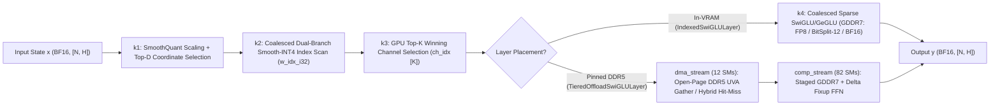
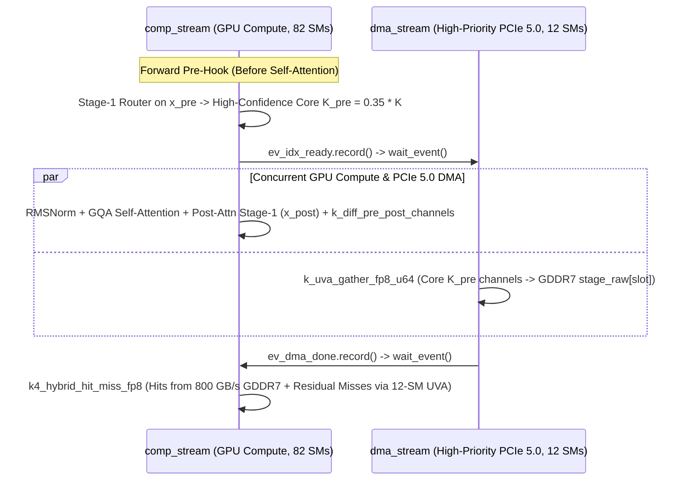

# FFMod System Architecture & Engineering Guide

**Version:** `ffmod v0.2.0` · **DOI:** [`10.5281/zenodo.24277071`](https://doi.org/10.5281/zenodo.24277071)  
🌐 **Language / Nyelv:** **🇬🇧 English** | [🇭🇺 Magyar (`SYSTEM_GUIDE_hu.md`)](SYSTEM_GUIDE_hu.md)  
**Related Docs:** [`README.md`](README.md) · [`USER_GUIDE_en.md`](USER_GUIDE_en.md) · [`EXPERIMENTAL_REPORT_en.md`](EXPERIMENTAL_REPORT_en.md) · [`IDEAS_en.md`](IDEAS_en.md) · [English Paper (PDF)](paper/ffmod_paper_en.pdf)

---

## Table of Contents

1. [System Architecture Overview](#1-system-architecture-overview)
2. [Codebase & Module Responsibility Map](#2-codebase--module-responsibility-map)
3. [Tensor Layouts & Byte-Level Memory Specification](#3-tensor-layouts--byte-level-memory-specification)
4. [Triton GPU Kernels & `torch.library.custom_op` Integration](#4-triton-gpu-kernels--torchlibrarycustom_op-integration)
5. [Tiered GPU–DDR5 + PCIe 5.0 Subsystem (`ffmod.tiered`)](#5-tiered-gpuddr5--pcie-50-subsystem-ffmodtiered)
6. [Persistent Weight-Index Cache Protocol (`.ffmod_cache_v1`)](#6-persistent-weight-index-cache-protocol-ffmod_cache_v1)
7. [KV-Cache Error Dynamics & Hybrid Layer Scheduling](#7-kv-cache-error-dynamics--hybrid-layer-scheduling)
8. [Extensibility & Verification Test Suites](#8-extensibility--verification-test-suites)

---

## 1. System Architecture Overview

`ffmod` resolves the memory-bandwidth bottleneck of modern Transformer decoding — gated FFN (`SwiGLU` / `GeGLU`) parameter streaming — by decoupling **static parameter storage** from **dynamic runtime compute planning**:



### Core Engineering Invariants
1. **100% Zero-Data, Zero-Training Construction:** Both the `Smooth-INT4` weight index and per-channel `FP8` scales are computed analytically from pretrained weight triplets ($W_{\text{gate}}, W_{\text{up}}, W_{\text{down}}$) without calibration datasets or fine-tuning.
2. **Zero CPU–GPU Synchronization in the Decode Loop:** Coordinate selection (`Top-D`), channel selection (`Top-K`), and atomic output reduction avoid `.item()` calls and dynamic allocations, guaranteeing **0 graph breaks under `torch.compile(..., fullgraph=True)` and 100% `torch.cuda.CUDAGraph` compatibility**.
3. **Strict VRAM-First Placement:** Whenever a model fits within the explicit or auto-detected GPU VRAM budget (`budget_bytes >= full_gpu_bytes`), FFMod allocates `0` bytes in host DDR5 RAM and installs `0` PCIe hooks.

---

## 2. Codebase & Module Responsibility Map

| Module | Primary Responsibility | Key Classes / Functions |
| :--- | :--- | :--- |
| [`ffmod/kernels.py`](ffmod/kernels.py) | Universal Stage-1 router and Stage-2 sparse FFN Triton kernels (`N=1..8`, `SwiGLU`/`GeGLU`, tiled `H > 4096` & `I > 16384`). | `k1_select_topd_coords`, `k2_scan_int4_scores_n1`, `k2_scan_int4_union_scores_nb`, `k3_select_topk_channels`, `k4_indexed_ffn_*` |
| [`ffmod/ops.py`](ffmod/ops.py) | Per-device L2-resident scratch workspace (`_DeviceWorkspace`) and PyTorch `custom_op` + `register_fake` registration. | `indexed_ffn_bf16`, `indexed_ffn_bitsplit12`, `indexed_ffn_fp8`, `_run_stage1_router`, `ensure_scratch_capacity` |
| [`ffmod/layers.py`](ffmod/layers.py) | GPU-resident indexed FFN module (`nn.Module`), `SmoothQuant` ($\alpha=0.5$) quantizer, and dense Tensor-Core prefill fallback (`N > 8`). | `IndexedSwiGLULayer`, `detect_act_mode` |
| [`ffmod/patcher.py`](ffmod/patcher.py) | Architecture-agnostic in-place model conversion (3-projection and `Phi-3` fused `gate_up_proj` MLPs) + KV-safe hybrid scheduling. | `patch_model`, `set_model_schedule`, `model_storage_bytes` |
| [`ffmod/io.py`](ffmod/io.py) | Single-file `safetensors` serialization/deserialization preserving tied `lm_head` / `embed_tokens` weights. | `save_indexed_safetensors`, `load_indexed_safetensors` |
| [`ffmod/tiered_kernels.py`](ffmod/tiered_kernels.py) | PCIe 5.0 12-SM Open-Page DDR5 UVA gather, O(1) L2 set-difference, and hybrid GDDR7-Hit + UVA-Miss Triton kernels. | `k_uva_gather_fp8_u64`, `k_diff_pre_post_channels`, `k4_staged_sparse_ffn_fp8`, `k4_hybrid_hit_miss_fp8` |
| [`ffmod/tiered.py`](ffmod/tiered.py) | Zero-RAM `meta`-skeleton `.safetensors` streaming loader, `auto` VRAM allocator, Pre-Attention / Cross-Layer hooks, and `.ffmod_cache_v1/` manager. | `TieredOffloadSwiGLULayer`, `TieredDevicePool`, `load_tiered_causal_lm`, `build_tiered_index_cache`, `release_tiered_model` |
| [`ffmod/engine.py`](ffmod/engine.py) | `StaticCache` + prompt-length-generalizing `CUDAGraph` decode engine, UTF-8-safe incremental BPE streaming, and live telemetry. | `FFModEngine`, `StreamDelta` |
| [`ffmod/server.py`](ffmod/server.py) | Multithreaded HTTP/1.1 + `SSE` OpenAI-compatible server (`/v1/chat/completions`, `/v1/completions`, `/v1/models`, `/health`). | `FFModOpenAIDispatcher`, `create_http_server`, `cli_main` |
| [`ffmod/vllm_plugin.py`](ffmod/vllm_plugin.py) | `vLLM` V0/V1 worker adapter operating directly on 2D `[num_tokens, H]` tensors. | `FFModVLLMMLP`, `apply_ffmod_to_vllm` |

---

## 3. Tensor Layouts & Byte-Level Memory Specification

Let $H$ denote hidden size, $I$ intermediate FFN channel count, $I_{\text{pad}} = \lceil I / 4 \rceil \times 4$, and $I_4 = I_{\text{pad}} / 4$.

### 3.1. Stage-1 `Smooth-INT4` Router Index
1. **Per-Column Activation-Weight Smoothing (`SmoothQuant`, $\alpha=0.5$):**
   $$c^{\text{gate}}_j = \left(\frac{1}{I}\sum_{i=1}^{I} (W^{\text{gate}}_{i,j})^2\right)^{1/4}, \qquad c^{\text{up}}_j = \left(\frac{1}{I}\sum_{i=1}^{I} (W^{\text{up}}_{i,j})^2\right)^{1/4}$$
   Multiplying input coordinates by $c_j$ (`col_gate_smooth [H]`, `col_up_smooth [H]`) while dividing weight columns prevents activation outlier channels from collapsing `INT4` dynamic range (`+14.1%p` Top-1 improvement).
2. **Asymmetric Offset-8 4-Bit Packing (`w_idx_i32 [H, I4]`, `int32`):**
   - Each weight is quantized into $0..15$ with zero-point $z = 8$ (`offset-8`, ensuring padded channels map cleanly to $q=8 \implies q - 8 = 0$).
   - Each byte packs `gate` in the low nibble and `up` in the high nibble: $\text{byte} = Q_{\text{gate}} \mid (Q_{\text{up}} \ll 4)$.
   - Four consecutive channels pack into a single coalesced 32-bit `int32` word (`[H, I_pad // 4]`). A single `[128]`-word warp load for a selected coordinate $d$ fetches **512 `(gate, up)` weight pairs in one 512-byte L2 transaction**!
3. **Fused Scale Vector (`scale_prod [2 * I_pad]`, `float32`):**
   - `[0 : I_pad]` stores $r^{\text{gate}}_i$ and `[I_pad : 2 I_pad]` stores $r^{\text{up}}_i$.

### 3.2. Stage-2 Channel-Major Payload Formats
Unlike standard matrix-major storage, `ffmod` stores FFN weights in **channel-major layout** so all three vectors of any winning channel $c \in \{0,\dots,I-1\}$ sit contiguously in memory:

| Payload Mode | Tensor(s) & Shape | Bytes per Channel ($H=2048$ / $H=5120$) | Net Model Size vs. Dense `BF16` |
| :--- | :--- | :---: | :---: |
| **`bf16`** | `w_channels_bf16: [I_pad, 3, H]` (`bfloat16`) | `12 KB` / `30 KB` | `+13.2%` *(INT4 index overhead only)* |
| **`bitsplit12`** | `w_gu_fp8: [I_pad, 2, H]` (`float8_e4m3fn`) + `w_d_bf16: [I_pad, H]` (`bfloat16`) + `gu_scales: [I_pad, 2]` | `8 KB` / `20 KB` | **`-13.0%` (0% extra VRAM!)** |
| **`fp8`** | `w_ch_fp8: [I_pad, 3, H]` (`float8_e4m3fn`) + `ch_scales: [I_pad, 3]` (`float32`) | **`6 KB` / `15 KB`** | **`-26.1%` (`1.35×–1.81×` smaller!)** |

---

## 4. Triton GPU Kernels & `torch.library.custom_op` Integration

### 4.1. Four-Stage Kernel Pipeline (`ffmod/kernels.py` & `ffmod/ops.py`)
1. **`k1_select_topd_coords` (`grid=(1,)`):** Computes coordinate importance $\max_{n=1..N} |x_{n,j}| \cdot \sqrt{c^{\text{gate}}_j c^{\text{up}}_j}$ and selects + pre-scales the `Top-D` coordinates (`xg_sub [N, D]`, `xu_sub [N, D]`).
2. **`k2_scan_int4_scores_n1` / `k2_scan_int4_union_scores_nb` (`grid=(ceil(I4 / BLOCK_I4),)`):** Reads only the `D` selected rows of `w_idx_i32`, unpacks 8 nibbles per `int32` word in registers, evaluates $|\text{act}(\hat{g}_i) \cdot \hat{u}_i| \cdot \|W_{\text{down}}[:,i]\|_2$ (or union score $\max_n |\text{act}(\hat{g}_{n,i}) \cdot \hat{u}_{n,i}|$ for `N=2..8`), and writes `scores [I_pad]`.
3. **`k3_select_topk_channels` (`grid=(1,)`):** Performs log-domain binary threshold search in L2 cache over `scores [I_pad]` to emit `ch_idx [K]` with zero CPU round-trips.
4. **`k4_indexed_ffn_*` (`grid=(NUM_PROGRAMS,)`):**
   - `NUM_PROGRAMS = min(num_sms, K)` persistent CTAs evaluate the `K` winning channels in parallel.
   - For micro-batches `N = 2..8` (e.g. speculative decoding), each winning channel's weights are loaded **once** from GDDR7 and broadcast across all `N` tokens in registers (*union-active register broadcast*), outperforming dense `cuBLAS` Tensor Cores by **`1.51×` at `N=4`**.
   - Accumulates into `ws.y_fp32 [N, H]` via `tl.atomic_add`; the final CTA (`tl.atomic_add(done_cnt, 1) == NUM_PROGRAMS - 1`) converts `y` to `BF16` and resets `done_cnt` in a fused epilogue!

### 4.2. Prompt-Length-Independent `CUDAGraph` Capture (`engine.py`)
`FFModEngine` captures a single decode step into `torch.cuda.CUDAGraph` at startup. To generalize across arbitrary prompt lengths $P$ without re-capturing, `cache_position [1]` and the 4D additive `attention_mask [1, 1, 1, max_cache_len]` are maintained as static GPU buffers mutated in-place (`fill_` / indexed assignment) prior to each `graph.replay()`.

---

## 5. Tiered GPU–DDR5 + PCIe 5.0 Subsystem (`ffmod.tiered`)

### 5.1. Why 12 SMs? — Physics of DDR5 Row-Buffer Bank Thrashing
When all 82 GPU SMs simultaneously issue Unified Virtual Addressing (`UVA`) reads to non-contiguous `15 KB` channels in pinned DDR5 RAM, concurrent requests continuously evict open DRAM row buffers (*page-miss* $t_{\text{RP}} + t_{\text{RCD}}$ stalls), capping gather throughput at `29.82 GB/s` while consuming 100% of GPU SMs.

Restricting `k_uva_gather_fp8_u64` to **`pcie_sms = 12` SMs** (`num_warps=8`, coalesced 64-bit `int64` row loads + `MADV_HUGEPAGE` 2 MB THP):
* Keeps host DDR5 banks in sequential *open-page burst* mode $\rightarrow$ **`38.83 GB/s` (`+30.2%`)** random channel gather bandwidth.
* Leaves **`70 / 82` SMs (`85.4%`) completely free** for concurrent GQA Attention and GPU-resident FFN execution on `comp_stream` (**`86.1%–99.2%` measured overlap**)!

### 5.2. Two-Stream `CUDAGraph` Fork-Join DAG (`pre_attn_exact_delta`)



* **Double-Buffered GDDR7 Staging Pool (`TieredDevicePool`):** `stage_raw [2, max_k * 3 * max_h]` alternates slots (`slot = pos % 2`) so Layer $(l+1)$'s prefetch can overlap with preceding GPU-resident Layer $l$'s FFN (*Cross-Layer Lookahead*).
* **OOM-Safe Layer Build Order (`load_tiered_causal_lm`):** Materializes non-FFN parameters on GPU first, queries `torch.cuda.mem_get_info()` when `vram_budget_gb="auto"`, and builds **GPU-resident FFN layers (`gpu_layer_set`) first** while maximum free VRAM headroom is available for temporary FP32 quantization buffers, followed by DDR5-offloaded layers.

---

## 6. Persistent Weight-Index Cache Protocol (`.ffmod_cache_v1`)

### Directory Layout & Atomic Consistency
```text
<model_dir>/.ffmod_cache_v1/
├── manifest.json            # Written ONLY after all L layer shards are verified on disk!
├── layer_000.safetensors    # Atomic write: layer_000.safetensors.tmp.<pid> -> os.replace()
├── layer_001.safetensors
└── ...
```

* **`manifest.json` Validation:** Stores a sorted `(filename, byte_size)` fingerprint (`source_fingerprint`) of the original HuggingFace `.safetensors` shards. Any source checkpoint change invalidates stale shards automatically.
* **Canonical 6-Tensor Schema per Layer:**
  - `w_idx_i32`: `[H, I_pad // 4]` (`int32`)
  - `w_ch_fp8`: `[I_pad, 3, H]` (`float8_e4m3fn`)
  - `ch_scales`: `[I_pad, 3]` (`float32`)
  - `col_gate_smooth`: `[H]` (`float32`), `col_up_smooth`: `[H]` (`float32`)
  - `scale_prod`: `[2 * I_pad]` (`float32`)
* **Contiguous `uint8` D2H DMA Optimization:** PyTorch lacks a vectorized strided CPU copy kernel for `float8_e4m3fn`, falling back to scalar byte loops (`~20 s/layer`). `ffmod` stacks `[Wg_fp8, Wu_fp8, Wd_fp8]` contiguously on GPU (`0.3 ms`) and performs a single contiguous `uint8` D2H DMA copy (`~8.5 ms/layer` — **`>2,000×` faster**).

---

## 7. KV-Cache Error Dynamics & Hybrid Layer Scheduling

Experiment 6 (`Exp 6`) demonstrated that FFN approximation error in early transformer layers writes slightly perturbed vectors into downstream `Key`/`Value` caches across all future tokens, whereas the final third of layers ($\ge \lfloor 2L/3 \rfloor$) minimally impacts subsequent Attention blocks. FFMod's default hybrid schedule therefore applies:
* **Layers $0 \dots \lfloor 2L/3 \rfloor - 1$:** conservative `sparsity` (e.g. `0.55` on 3B, `0.65` on 32B),
* **Layers $\lfloor 2L/3 \rfloor \dots L - 1$:** aggressive `late_sparsity` (e.g. `0.75–0.80`).

---

## 8. Extensibility & Verification Test Suites

### Supporting New Transformer Architectures
[`ffmod/patcher.py`](ffmod/patcher.py) automatically handles:
1. Standard 3-projection (`gate_proj`, `up_proj`, `down_proj`) MLPs (`Llama`, `Qwen2/2.5/3`, `Mistral`, `Gemma`, `DeepSeek`),
2. Fused 2-projection (`gate_up_proj`, `down_proj`) MLPs (`Phi-3`, `GLM`).

To add a new gated activation function:
1. Extend `detect_act_mode(mlp)` in [`ffmod/layers.py`](ffmod/layers.py),
2. Add the corresponding `ACT_TYPE` branch in [`ffmod/kernels.py`](ffmod/kernels.py) and [`ffmod/tiered_kernels.py`](ffmod/tiered_kernels.py).

### Running Automated GPU Verification Suites
```bash
# 1. Core package, kernels (BF16 / BitSplit-12 / FP8, 70B shapes, N=1..32, torch.compile, safetensors):
.venv/bin/python tests/test_milestone1_package.py

# 2. OpenAI HTTP + SSE streaming server & telemetry tests:
.venv/bin/python tests/test_milestone3_server.py

# 3. PCIe 5.0 Tiered engine, bit-exact .ffmod_cache_v1 reload & 2-stream CUDAGraph tests:
.venv/bin/python tests/test_tiered_prefetch.py
```
