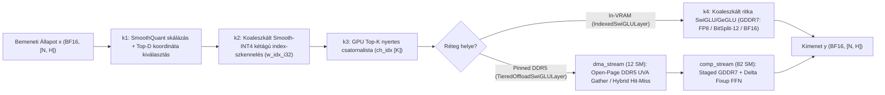
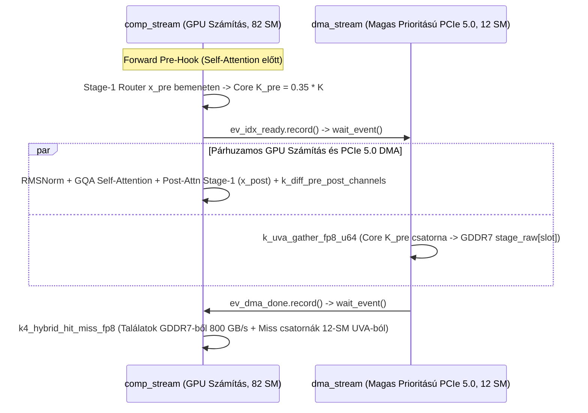

# FFMod Rendszerarchitektúra és Mérnöki Kézikönyv (System Guide)

**Verzió:** `ffmod v0.2.0` · **DOI:** [`10.5281/zenodo.24277071`](https://doi.org/10.5281/zenodo.24277071)  
🌐 **Nyelv / Language:** [🇬🇧 English (`SYSTEM_GUIDE_en.md`)](SYSTEM_GUIDE_en.md) | **🇭🇺 Magyar**  
**Kapcsolódó dokumentumok:** [`README_hu.md`](README_hu.md) · [`USER_GUIDE_hu.md`](USER_GUIDE_hu.md) · [`EXPERIMENTAL_REPORT_hu.md`](EXPERIMENTAL_REPORT_hu.md) · [`IDEAS_hu.md`](IDEAS_hu.md) · [Angol cikk (PDF)](paper/ffmod_paper_en.pdf) · [Magyar cikk (PDF)](paper/ffmod_paper_hu.pdf)

---

## Tartalomjegyzék

1. [Rendszerarchitektúra Áttekintés](#1-rendszerarchitektúra-áttekintés)
2. [Kódbázis és Moduláris Felelősségi Térkép](#2-kódbázis-és-moduláris-felelősségi-térkép)
3. [Tenzor-Elrendezések és Bájtszintű Memóriaspecifikáció](#3-tenzor-elrendezések-és-bájtszintű-memóriaspecifikáció)
4. [Triton GPU Kernelek és `torch.library.custom_op` Integráció](#4-triton-gpu-kernelek-és-torchlibrarycustom_op-integráció)
5. [Rétegzett GPU–DDR5 + PCIe 5.0 Alrendszer (`ffmod.tiered`)](#5-rétegzett-gpuddr5--pcie-50-alrendszer-ffmodtiered)
6. [Perzisztens Súlyindex-Gyorsítótár Protokoll (`.ffmod_cache_v1`)](#6-perzisztens-súlyindex-gyorsítótár-protokoll-ffmod_cache_v1)
7. [KV-Cache Hiba-Dinamika és Hibrid Réteg-Ütemezés](#7-kv-cache-hiba-dinamika-és-hibrid-réteg-ütemezés)
8. [Bővíthetőség és Verifikációs Tesztcsomagok](#8-bővíthetőség-és-verifikációs-tesztcsomagok)

---

## 1. Rendszerarchitektúra Áttekintés

Az `ffmod` a modern transzformerek dekódolási szűk keresztmetszetét — az FFN (`SwiGLU` / `GeGLU`) rétegek memória-sávszélesség korlátját — a **tárolt paraméterek** és a **futásidejű számítási terv** szétválasztásával oldja fel:



### Fő tervezési invariánsok
1. **100% adat- és tanításmentesség (*Zero-Data, Zero-Training*):** A `Smooth-INT4` súlyindex és a csatornánkénti `FP8` skálák kizárólag a statikus súlymátrixokból ($W_{\text{gate}}, W_{\text{up}}, W_{\text{down}}$) épülnek fel analitikus képletekkel, kalibrációs adathalmaz és finomhangolás nélkül.
2. **Zéró CPU–GPU szinkronizáció a dekódolási hurokban:** Sem a `Top-D` koordináta-szelekció, sem a `Top-K` csatorna-kiválasztás, sem az atomi kimeneti redukció nem használ `.item()` vagy dinamikus allokációs hívást, így a teljes modell **0 gráf-töréssel fut `torch.compile(..., fullgraph=True)` és `torch.cuda.CUDAGraph` alatt**.
3. **Szigorú VRAM-első elhelyezés:** Ha a modell befér a célzott vagy automatikusan detektált VRAM-keretbe (`budget_bytes >= full_gpu_bytes`), a motor `0` bájtot foglal rendszermemóriában és `0` PCIe hookot regisztrál.

---

## 2. Kódbázis és Moduláris Felelősségi Térkép

| Modul | Elsődleges Felelősség | Fő Osztályok / Függvények |
| :--- | :--- | :--- |
| [`ffmod/kernels.py`](ffmod/kernels.py) | Univerzális Stage-1 router és Stage-2 ritka FFN Triton kernelek (`N=1..8`, `SwiGLU`/`GeGLU`, csempézett `H > 4096` és `I > 16384`). | `k1_Select_topd_coords`, `k2_scan_int4_scores_n1`, `k2_scan_int4_union_scores_nb`, `k3_select_topk_channels`, `k4_indexed_ffn_*` |
| [`ffmod/ops.py`](ffmod/ops.py) | L2-rezidens scratchpad munkaterület (`_DeviceWorkspace`) és PyTorch `custom_op` + `register_fake` regisztráció. | `indexed_ffn_bf16`, `indexed_ffn_bitsplit12`, `indexed_ffn_fp8`, `_run_stage1_router`, `ensure_scratch_capacity` |
| [`ffmod/layers.py`](ffmod/layers.py) | GPU-rezidens indexelt FFN réteg (`nn.Module`), `SmoothQuant` ($\alpha=0.5$) kvantáló és prefill Tensor-Core fallback (`N > 8`). | `IndexedSwiGLULayer`, `detect_act_mode` |
| [`ffmod/patcher.py`](ffmod/patcher.py) | Architektúra-agnosztikus in-place modellkonverzió (három-projekciós és `Phi-3` fuzionált `gate_up_proj` rétegekhez) + KV-biztos ütemezés. | `patch_model`, `set_model_schedule`, `model_storage_bytes` |
| [`ffmod/io.py`](ffmod/io.py) | Egyfájlos `safetensors` szerializáció/deszerializáció megosztott (`tied`) `lm_head` súlyok kezelésével. | `save_indexed_safetensors`, `load_indexed_safetensors` |
| [`ffmod/tiered_kernels.py`](ffmod/tiered_kernels.py) | PCIe 5.0 12-SM Open-Page DDR5 UVA begyűjtő, O(1) L2 halmazkülönbség és hibrid GDDR7-Hit + UVA-Miss Triton kernelek. | `k_uva_gather_fp8_u64`, `k_diff_pre_post_channels`, `k4_staged_sparse_ffn_fp8`, `k4_hybrid_hit_miss_fp8` |
| [`ffmod/tiered.py`](ffmod/tiered.py) | `Meta`-váz alapú `.safetensors` streamelő betöltő, `auto` VRAM-allokátor, Pre-Attention / Cross-Layer hookok és `.ffmod_cache_v1/` kezelő. | `TieredOffloadSwiGLULayer`, `TieredDevicePool`, `load_tiered_causal_lm`, `build_tiered_index_cache`, `release_tiered_model` |
| [`ffmod/engine.py`](ffmod/engine.py) | `StaticCache` + általános prompt-hosszúságú `CUDAGraph` dekódoló motor, UTF-8 biztonságos BPE streaming és telemetria. | `FFModEngine`, `StreamDelta` |
| [`ffmod/server.py`](ffmod/server.py) | Többszálú HTTP/1.1 + `SSE` OpenAI-kompatibilis szerver (`/v1/chat/completions`, `/v1/completions`, `/v1/models`, `/health`). | `FFModOpenAIDispatcher`, `create_http_server`, `cli_main` |
| [`ffmod/vllm_plugin.py`](ffmod/vllm_plugin.py) | `vLLM` V0/V1 worker-oldali adapter 2D `[num_tokens, H]` tenzorokhoz. | `FFModVLLMMLP`, `apply_ffmod_to_vllm` |

---

## 3. Tenzor-Elrendezések és Bájtszintű Memóriaspecifikáció

Legyen $H$ a rejtett dimenzió, $I$ a közbülső FFN csatornaszám, $I_{\text{pad}} = \lceil I / 4 \rceil \times 4$, és $I_4 = I_{\text{pad}} / 4$.

### 3.1. 1. lépcső (`Stage-1` Smooth-INT4 Router Index)
1. **Oszloponkénti aktivációs-súly kiegyenlítés (`SmoothQuant`, $\alpha=0.5$):**
   $$c^{\text{gate}}_j = \left(\frac{1}{I}\sum_{i=1}^{I} (W^{\text{gate}}_{i,j})^2\right)^{1/4}, \qquad c^{\text{up}}_j = \left(\frac{1}{I}\sum_{i=1}^{I} (W^{\text{up}}_{i,j})^2\right)^{1/4}$$
   A bemenet oszloponként megszorzódik $c_j$-vel (`col_gate_smooth [H]`, `col_up_smooth [H]`), míg a súlymátrix elosztódik vele — megakadályozva, hogy néhány kiugró (*outlier*) koordináta elnyomja az `INT4` dinamikatartományt (`+14.1%p` Top-1 javulás).
2. **Aszimmetrikus eltolt 4 bites csomagolás (`w_idx_i32 [H, I4]`, `int32`):**
   - Minden elem 0..15 közé kvantálódik $z = 8$ zérusponttal (`offset-8`, így a padding csatornák $q=8 \implies q - 8 = 0$ értéket kapnak).
   - Egyetlen bájt alsó 4 bitje a `gate`, felső 4 bitje az `up` kvantált súlyát tárolja: $\text{byte} = Q_{\text{gate}} \mid (Q_{\text{up}} \ll 4)$.
   - Négy szomszédos csatorna 4 bájtja egyetlen koaleszkált 32 bites `int32` szóba csomagolódik (`[H, I_pad // 4]`). Amikor egy warp beolvas egy `[128]`-as `int32` szeletet egy kiválasztott $d$ koordinátához, **egyetlen 512 bájtos L2 tranzakcióval 512 darab `(gate, up)` súlypárt** tölt be regiszterbe!
3. ** Előre összevont skálatömb (`scale_prod [2 * I_pad]`, `float32`):**
   - `[0 : I_pad]` = $r^{\text{gate}}_i$, `[I_pad : 2 I_pad]` = $r^{\text{up}}_i$.

### 3.2. 2. lépcső (`Stage-2` Csatorna-Major Payload Formátumok)
A hagyományos mátrix-major tárolással szemben az `ffmod` csatorna-major elrendezést használ, így egyetlen nyertes $c \in \{0,\dots,I-1\}$ csatorna összes súlya **egymás mellett, folytonosan** fekszik a memóriában:

| Payload Mód | Tenzor(ok) és Alak | Csatorna Méret ($H=2048$ / $H=5120$) | Nettó Modellméret vs. Sűrű `BF16` |
| :--- | :--- | :---: | :---: |
| **`bf16`** | `w_channels_bf16: [I_pad, 3, H]` (`bfloat16`) | `12 KB` / `30 KB` | `+13.2%` *(csak az INT4 index többlete)* |
| **`bitsplit12`** | `w_gu_fp8: [I_pad, 2, H]` (`float8_e4m3fn`) + `w_d_bf16: [I_pad, H]` (`bfloat16`) + `gu_scales: [I_pad, 2]` | `8 KB` / `20 KB` | **`-13.0%` (0% extra VRAM!)** |
| **`fp8`** | `w_ch_fp8: [I_pad, 3, H]` (`float8_e4m3fn`) + `ch_scales: [I_pad, 3]` (`float32`) | **`6 KB` / `15 KB`** | **`-26.1%` (`1.35×–1.81×` kisebb!)** |

---

## 4. Triton GPU Kernelek és `torch.library.custom_op` Integráció

### 4.1. Négyfázisú Kernel Pipeline (`ffmod/kernels.py` & `ffmod/ops.py`)
1. **`k1_select_topd_coords` (`grid=(1,)`):** Kiszámolja $\max_{n=1..N} |x_{n,j}| \cdot \sqrt{c^{\text{gate}}_j c^{\text{up}}_j}$ fontosságot, és ciklusonként bitmaszkos redukcióval kiválasztja a `Top-D` koordinátát + előskálázza őket (`xg_sub [N, D]`, `xu_sub [N, D]`).
2. **`k2_scan_int4_scores_n1` / `k2_scan_int4_union_scores_nb` (`grid=(ceil(I4 / BLOCK_I4),)`):** Csak a `D` kiválasztott sort olvassa be a `w_idx_i32` táblából, regiszterben kicsomagolja a 8 darab 4 bites értéket `int32` szavanként, kiszámolja $|\text{act}(\hat{g}_i) \cdot \hat{u}_i|$ becslést (mikro-batch `N=2..8` esetén $\max_n |\text{act}(\hat{g}_{n,i}) \cdot \hat{u}_{n,i}|$ unió-pontszámot!), és kiírja `scores [I_pad]`-ba.
3. **`k3_select_topk_channels` (`grid=(1,)`):** A GPU L2 gyorsítótárában lévő `scores [I_pad]` vektorból küszöb-kereséssel (vagy kis $I$ esetén közvetlen Top-K-val) előállítja a `ch_idx [K]` tömböt CPU visszacsatolás nélkül.
4. **`k4_indexed_ffn_*` (`grid=(NUM_PROGRAMS,)`):**
   - `NUM_PROGRAMS = min(num_sms, K)` perzisztens programblokk párhuzamosan dolgozza fel a `K` nyertes csatornát.
   - `N = 2..8` (pl. spekulatív dekódolás) esetén minden kiválasztott csatorna súlyvektorát **egyetlenegyszer** olvassa be a GDDR7-ből, és regiszterben szorozza össze mind az `N` token bemenetével (*union-active register broadcast*), így `N=4` mellett is **`1.51×` gyorsabb a sűrű `cuBLAS` Tensor Core GEMM-nél**.
   - A részeredményeket `ws.y_fp32 [N, H]`-ba összegzi `tl.atomic_add`-dal, majd az utolsóként végző programblokk (`tl.atomic_add(done_cnt, 1) == NUM_PROGRAMS - 1`) egyetlen fuzionált epilógusban `BF16`-ra konvertálja `y`-t és kinullázza `done_cnt`-t a következő réteg számára!

### 4.2. `CUDAGraph` Biztonság (`StaticCache` Pozíció-Függetlenség az `engine.py`-ban)
Az `FFModEngine` induláskor egyetlen dekódolási lépést rögzít `torch.cuda.CUDAGraph`-ba. Hogy a rögzített gráf bármilyen $P$ prompt-hosszúság után újrahasznosítható legyen újrafordítás nélkül, a `cache_position [1]` és a 4D additív `attention_mask [1, 1, 1, max_cache_len]` fix GPU tenzorként szerepelnek, amelyeket az `engine` lépésenként in-place (`fill_` / indexelt írással) frissít a `graph.replay()` előtt.

---

## 5. Rétegzett GPU–DDR5 + PCIe 5.0 Alrendszer (`ffmod.tiered`)

### 5.1. Miért 12 SM? — A DDR5 Row-Buffer Bank-Thrashing Fizikája
Ha mind a 82 GPU SM egyszerre indít Unified Virtual Addressing (`UVA`) olvasásokat a lefoglalt (*pinned*) DDR5 memóriában szétszórt `15 KB`-os csatornákra, a párhuzamos memóriakérések másodpercenként milliószor nyitnak és zárnak különböző DRAM sorokat (*page-miss* $t_{\text{RP}} + t_{\text{RCD}}$ késleltetés), ami `29.82 GB/s`-ra rontja az átvitelt és lefoglalja az összes SM-et.

A `k_uva_gather_fp8_u64` kernelt **`pcie_sms = 12` SM-re** (`num_warps=8`, 64 bites `int64` koaleszkált sorolvasás + `MADV_HUGEPAGE` 2 MB THP) korlátozva:
* A DDR5 bankok szekvenciális *open-page burst* módban maradnak $\rightarrow$ **`38.83 GB/s` (`+30.2%`)** valós begyűjtési sávszélesség.
* **`70 / 82` SM (`85.4%`) teljesen szabad marad** a `comp_stream`-en futó GQA Attention és GPU FFN rétegek számára (**`86.1%–99.2%` átfedés**)!

### 5.2. Két-Streames `CUDAGraph` Fork-Join DAG (`pre_attn_exact_delta`)



* **Dupla-pufferelt GDDR7 Staging Pool (`TieredDevicePool`):** A `stage_raw [2, max_k * 3 * max_h]` két váltakozó (`slot = pos % 2`) puffert tart fenn, így az $(l+1)$ réteg előtöltése már az $l$. GPU-rezidens réteg FFN számítása közben elindulhat (*Cross-Layer Lookahead*).
* **OOM-mentes Rétegépítési Sorrend (`load_tiered_causal_lm`):** Először a `meta` váz nem-FFN paramétereit tölti GPU-ra, majd `vram_budget_gb="auto"` esetén lekérdezi `torch.cuda.mem_get_info()` szabad bájtszámát (`2.0 GB` KV-tartalékkal). Ezután **először a GPU-rezidens FFN rétegeket (`gpu_layer_set`) építi fel**, amíg bőven van szabad VRAM az ideiglenes FP32 kvantálási tenzoroknak, és csak utána a DDR5-be kiszervezett rétegeket.

---

## 6. Perzisztens Súlyindex-Gyorsítótár Protokoll (`.ffmod_cache_v1`)

### Könyvtárszerkezet és Atomi Konzisztencia
```text
<model_dir>/.ffmod_cache_v1/
├── manifest.json            # Csak akkor íródik ki, ha mind az L réteg hiánytalanul elkészült!
├── layer_000.safetensors    # Atomi írás: layer_000.safetensors.tmp.<pid> -> os.replace()
├── layer_001.safetensors
└── ...
```

* **`manifest.json` érvényesítés:** Tárolja az eredeti HuggingFace `.safetensors` fájlok rendezett `(fájlnév, bájtméret)` ujjlenyomatát (`source_fingerprint`). Ha a modell súlyai megváltoznak vagy egy rétegfájl hiányzik, a betöltő automatikusan újraépíti csak a hiányzó elemeket.
* **Kanonikus 6-tenzoros séma rétegenként:**
  - `w_idx_i32`: `[H, I_pad // 4]` (`int32`)
  - `w_ch_fp8`: `[I_pad, 3, H]` (`float8_e4m3fn`)
  - `ch_scales`: `[I_pad, 3]` (`float32`)
  - `col_gate_smooth`: `[H]` (`float32`), `col_up_smooth`: `[H]` (`float32`)
  - `scale_prod`: `[2 * I_pad]` (`float32`)
* **D2H DMA optimalizáció:** A PyTorch CPU-oldali nem-folytonos (*strided*) `float8_e4m3fn` másolása vektorizáció híján skalár bájtonkénti ciklusra esik vissza (`~20 s/réteg`). Az `ffmod` ezért GPU-n fűzi össze folytonos `[I, 3, H]` tenzorrá a három projekciót (`0.3 ms`), és `uint8` nézeten keresztül egyetlen folytonos DMA-val másolja át (`~8.5 ms/réteg` — **`>2,000×` gyorsabb**).

---

## 7. KV-Cache Hiba-Dinamika és Hibrid Réteg-Ütemezés

A 6. kísérlet (`Exp 6`) kimutatta, hogy egy $L$ rétegű transzformerben a korai rétegek FFN-approximációs hibája beíródik az összes későbbi réteg `Key` és `Value` gyorsítótárába, míg az utolsó harmad ($\ge \lfloor 2L/3 \rfloor$) rétegeinek hibája már alig lép kölcsönhatásba későbbi Attention blokkokkal. Ezért az `ffmod` alapértelmezett hibrid ütemezése:
* **$0 \dots \lfloor 2L/3 \rfloor - 1$ rétegek:** konzervatívabb `sparsity` (pl. `0.55` 3B-n, `0.65` 32B-n),
* **$\lfloor 2L/3 \rfloor \dots L - 1$ rétegek:** agresszívabb `late_sparsity` (pl. `0.75–0.80`).

---

## 8. Bővíthetőség és Verifikációs Tesztcsomagok

### Új transzformer architektúra támogatása
A [`ffmod/patcher.py`](ffmod/patcher.py) modul automatikusan felismeri:
1. A standard három-projekciós (`gate_proj`, `up_proj`, `down_proj`) modulokat (`Llama`, `Qwen2/2.5/3`, `Mistral`, `Gemma`, `DeepSeek`),
2. A fuzionált két-projekciós (`gate_up_proj`, `down_proj`) modulokat (`Phi-3`, `GLM`).

Új aktivációs függvény hozzáadásához:
1. Egészítsd ki a `detect_act_mode(mlp)` függvényt a [`ffmod/layers.py`](ffmod/layers.py) fájlban,
2. Add hozzá a megfelelő `ACT_TYPE` konstans ágat a [`ffmod/kernels.py`](ffmod/kernels.py) és [`ffmod/tiered_kernels.py`](ffmod/tiered_kernels.py) kernelekhez.

### Automatizált GPU Tesztcsomagok Futtatása
```bash
# 1. Csomag, kernelek (BF16 / BitSplit-12 / FP8, 70B méretek, N=1..32, torch.compile, safetensors):
.venv/bin/python tests/test_milestone1_package.py

# 2. OpenAI HTTP + SSE streaming szerver és telemetria tesztek:
.venv/bin/python tests/test_milestone3_server.py

# 3. PCIe 5.0 Tiered motor, perzisztens .ffmod_cache_v1 bitpontos egyezés és 2-streames CUDAGraph tesztek:
.venv/bin/python tests/test_tiered_prefetch.py
```
